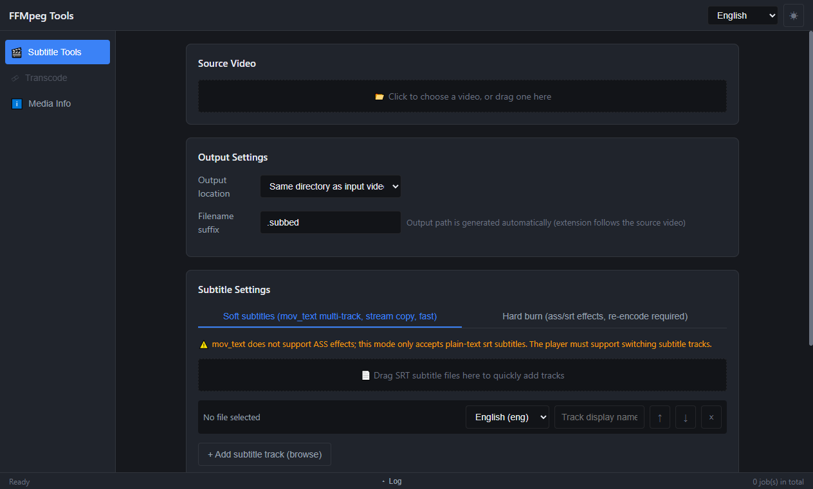
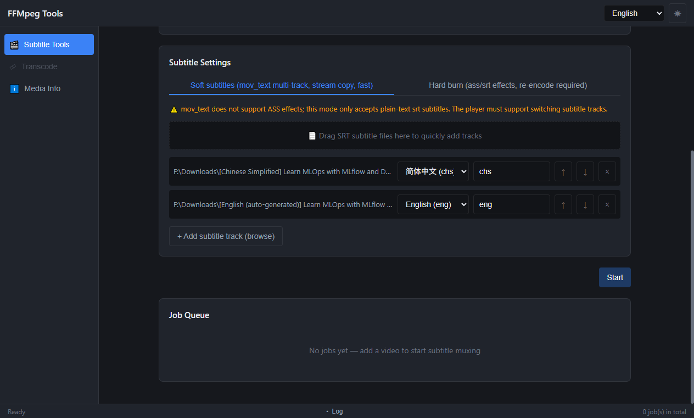
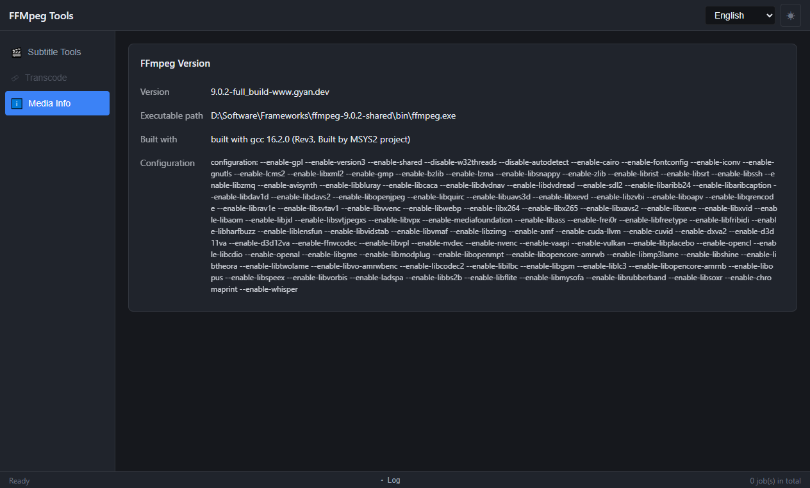

<p align="right"><b>English</b> | <a href="README.zh-CN.md">简体中文</a></p>

# FFMpeg Tools

A cross-platform desktop FFmpeg toolkit built with **Go 1.26 + [Wails v2.16.0](https://wails.io)** and a **Vue 3 + TypeScript + Vite** frontend.

The current release focuses on subtitle workflows for MP4 video: muxing multiple soft subtitle tracks without re-encoding, or burning a subtitle into the picture.

## Features

- **Soft subtitles (mux)** — attach multiple `.srt` tracks as `mov_text` streams. Video and audio streams are copied (`-c:v copy -c:a copy`), so the job is fast and lossless. Each track carries its own `language` and `title` metadata, so players show a proper subtitle selector.
- **Hard subtitles (burn-in)** — render the first track into the video through the `subtitles` filter, with optional `FontName` / `FontSize` override and a custom font directory (`fontsdir`). Audio is copied.
- **Language auto-detection** — infers the language code from the subtitle file name (`chs`, `cht`, `eng`, `jpn`, `kor`, plus Chinese/English naming variants) and normalizes shortcuts like `chs`/`zh-hans` to ISO 639-2 tags.
- **Flexible output paths** — choose a custom destination, write next to the source video, or write next to the executable, with a configurable file-name suffix (default `.subbed`; the output extension follows the source video's container).
- **Drag & drop** — drop video and subtitle files directly onto the corresponding UI zones.
- **Real-time progress & logs** — duration is probed with `ffprobe`, progress is parsed from ffmpeg output and throttled to ~5 events/s, and each job keeps a full log including the exact command line executed.
- **Concurrency & cancellation** — submit multiple jobs at once; each runs in its own goroutine and can be cancelled individually.
- **Job queue view** — jobs are listed in submission order with status (`pending` / `running` / `done` / `error` / `cancelled`), plus a global bottom log panel.
- **i18n** — Simplified Chinese, English, and Japanese (fallback: `zh-CN`).
- **Light / dark theme**.

## Screenshots

**Subtitle tools — source video & output settings** (suffix-only naming; the output extension follows the source video's container):



**Multi-track subtitle queue** — tracks were added by drag & drop; language and display name are auto-detected from the file names (`chs` for the Simplified Chinese track, `eng` for the auto-generated English one):



**Media Info** — the bundled ffmpeg's version, executable path, build toolchain and full compile configuration:



## Tech stack

| Layer | Choices |
|-------|---------|
| Desktop runtime | Wails v2.16.0 (CLI pinned to v2.16.0) |
| Backend | Go 1.26, `github.com/google/uuid` |
| Frontend | Vue 3.5, TypeScript 5.6, Vite 5.4, Pinia 2, vue-i18n 11, Sass |
| Media engine | ffmpeg / ffprobe (external binary) |
| Package manager | pnpm (install) · npm (build scripts, as configured in `wails.json`) |

## Project layout

```
go-ffmpeg-tools/
├── main.go                 # Wails bootstrap, embeds frontend/dist, file-drop options
├── app.go                  # App bindings: SubmitJob / CancelJob / GetJobs / file dialogs
├── internal/
│   ├── task/               # Job + SubConfig model, concurrency-safe task manager
│   └── ffmpeg/             # Argument builder, process runner (per-platform impls)
├── frontend/
│   └── src/
│       ├── views/Index.vue # Subtitle tools page (main UI)
│       ├── components/     # JobCard / LogPanel / SubTrackRow
│       ├── stores/jobs.ts  # Pinia job store, listens to "jobUpdate" events
│       ├── i18n/locales/   # zh-CN / en / ja
│       └── wailsjs/        # Generated bindings — do not edit by hand
├── build.ps1               # Packaging script
└── wails.json              # Wails project config
```

## How it works

`app.go` exposes these methods to the frontend via Wails bindings:

| Method | Purpose |
|--------|---------|
| `SubmitJob(SubmitJobReq)` | Resolve the output path, register the job, run ffmpeg asynchronously, return an immediate snapshot |
| `CancelJob(jobId)` | Cancel a running job through its context |
| `GetJobs()` | List all job snapshots in submission order |
| `SelectFile` / `SelectOutputFile` | Native open / save dialogs |

Job state is pushed to the UI through the `jobUpdate` Wails event.

FFmpeg argument construction lives in `internal/ffmpeg/builder.go`:

- **soft**: `-i video -i sub1 -i sub2 ... -map 0:v -map 0:a? -c:v copy -c:a copy`, then per track `-map N:0 -c:s:N mov_text -metadata:s:s:N language=... title=...`. ASS tracks are rejected here because `mov_text` cannot represent ASS styling.
- **burn**: `-vf subtitles=filename='...':fontsdir='...':force_style='...' -c:a copy`. Filter paths go through `escapeFilterPath` to handle Windows drive-letter colons and filter separator characters.

## ffmpeg binary

Search order at runtime:

1. `<executable dir>/build/ffmpeg/<GOOS>/ffmpeg(.exe)` (and the same for `ffprobe`)
2. `ffmpeg` / `ffprobe` from `PATH`

Place platform builds under `build/ffmpeg/windows/`, `build/ffmpeg/darwin/`, `build/ffmpeg/linux/`. `build.ps1` copies the matching directory into the output automatically. On Windows the child process is started with `CREATE_NO_WINDOW` so no console flashes.

## Prerequisites

- Go ≥ 1.26
- Node.js ≥ 20 and pnpm
- Wails CLI v2.16.0 (`go install github.com/wailsapp/wails/v2/cmd/wails@v2.16.0`) — `build.ps1` installs it automatically if missing
- ffmpeg / ffprobe (bundled under `build/ffmpeg/<os>/` or available on `PATH`)
- Windows: WebView2 runtime; Linux: the GTK/webkit2gtk toolchain required by Wails

## Build and run

```powershell
# Package for the current platform
.\build.ps1

# Debug binary
.\build.ps1 -DebugBuild

# Cross-platform (space-separated list)
.\build.ps1 -Platform "windows/amd64 linux/amd64"
```

Artifacts land in `build/bin/` (git-ignored, never commit them).

Other common commands:

```powershell
wails dev                    # hot-reload development

cd frontend; npm run build   # frontend type-check (vue-tsc --noEmit) + bundle

go build ./...               # backend compile check
go vet ./...
```

Regenerate the frontend bindings after adding or changing `App` methods:

```powershell
wails generate module
```

### App icons

`./generate-icon.ps1` rasterizes `frontend/public/favicon.svg` into `build/appicon.png` (1024px) and `build/windows/icon.ico`. It tries ImageMagick → Inkscape → headless Edge/Chrome, falling back to System.Drawing for the ICO. Run it whenever the SVG changes.

## Known limitations

- `mov_text` soft subtitles accept SRT only; ASS requires burn mode.
- Burn-in re-encodes the video stream, so it is significantly slower than muxing.
- Only the first subtitle track is burned in burn mode.
- No unit tests in the Go backend yet.

## Roadmap ideas

Format conversion, compression/resize, audio extraction, clip cutting, batch queues, and per-profile output presets — the architecture (`internal/ffmpeg` builders + `internal/task` manager) is designed to accommodate additional tool pages.

## License

TBD — add a `LICENSE` file before publishing.
