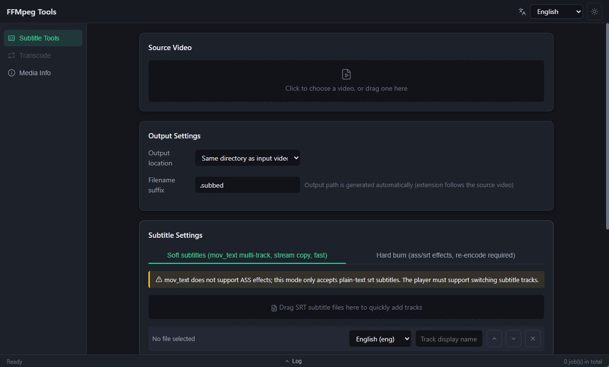
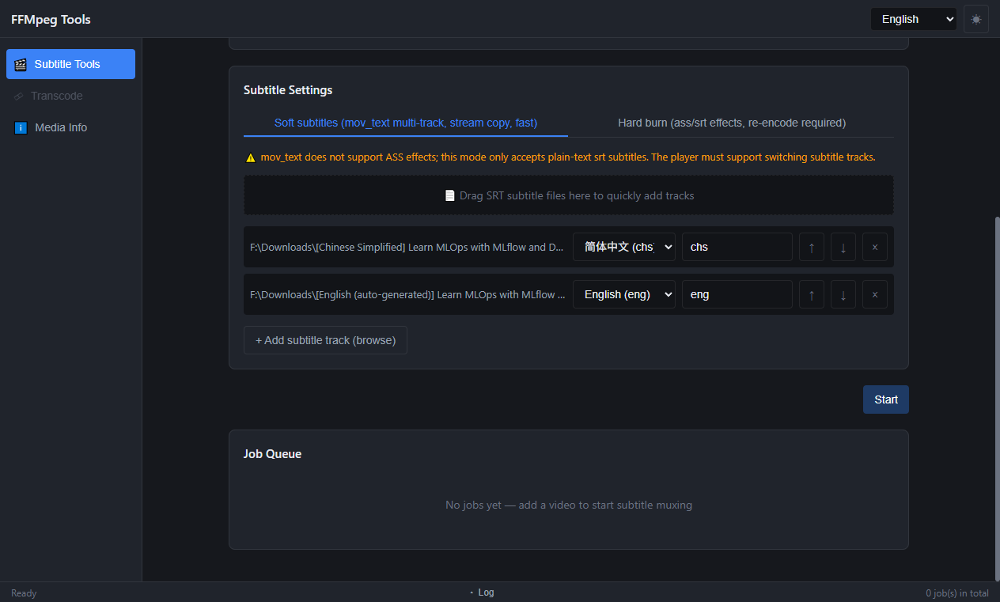
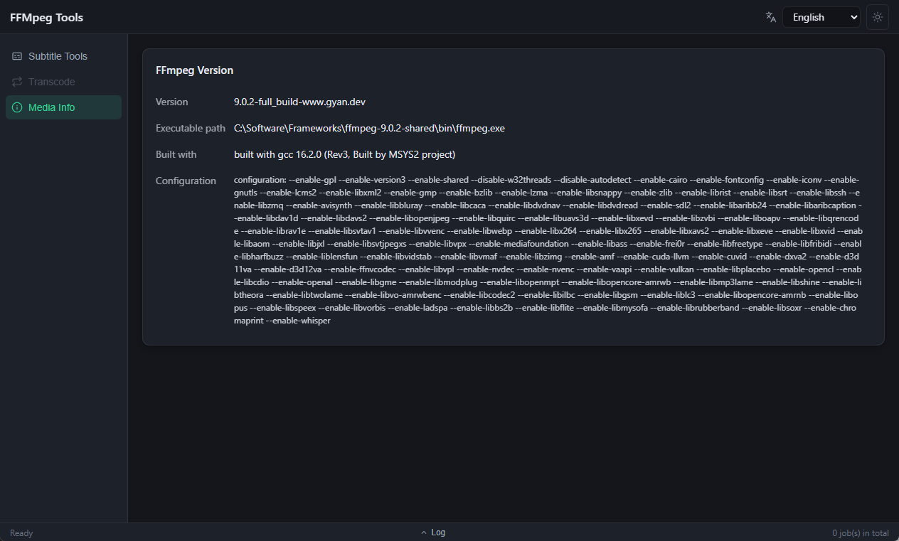

<p align="right"><a href="README.md">English</a> | <b>简体中文</b></p>

# FFMpeg Tools

    

基于 Vue 3 + TypeScript 前端构建的跨平台桌面 FFmpeg 工具箱。

当前版本聚焦 MP4 视频的字幕处理：既支持多轨软字幕封装（不重编码），也支持字幕硬烧录。

## 功能特性

- **软字幕（封装）** — 将多条 `.srt` 字幕以 `mov_text` 流封装进容器，视频音频流直接复制（`-c:v copy -c:a copy`），速度快且无损。每条轨道独立写入 `language` 与 `title` 元数据，播放器中可直接切换字幕轨。
- **硬字幕（烧录）** — 通过 `subtitles` 滤镜将第一条字幕渲染进画面，支持 `FontName` / `FontSize` 样式覆盖与自定义字体目录（`fontsdir`），音频流复制。
- **语言自动识别** — 从字幕文件名推断语言代码（`chs`、`cht`、`eng`、`jpn`、`kor`，兼容中英文命名习惯），并将 `chs`/`zh-hans` 等缩写归一化为 ISO 639-2 标签。
- **灵活的输出路径** — 手动指定、与源视频同目录、或程序可执行文件目录，文件名后缀可配置（默认 `.subbed`；输出扩展名跟随源视频容器）。
- **拖拽导入** — 视频与字幕文件可直接拖拽到界面对应区域。
- **实时进度与日志** — 使用 `ffprobe` 探测总时长，从 ffmpeg 输出解析进度，事件推送节流至约每秒 5 次；每个任务保留完整日志，含实际执行的命令行。
- **并发与取消** — 可同时提交多个任务，各自运行在独立 goroutine 中，并支持单个任务取消。
- **任务队列视图** — 按提交顺序展示任务与状态（`pending` / `running` / `done` / `error` / `cancelled`），并提供底部全局日志面板。
- **多语言界面** — 简体中文、英文、日文（默认回退 `zh-CN`）。
- **浅色 / 深色主题**。

## 截图

**字幕工具 — 源视频与输出设置**（文件名后缀只保留 `.subbed`，输出扩展名跟随源视频容器）：



**多轨道字幕配置** — 轨道由拖拽添加，语言与显示名称从文件名自动识别（简体中文字幕识别为 `chs`，自动生成的英文字幕识别为 `eng`）：



**媒体信息** — 展示实际使用的 ffmpeg 版本号、可执行文件路径、编译环境与完整编译配置：



## 技术栈

| 层级 | 选型 |
|------|------|
| 桌面运行时 | Wails v2.16.0（CLI 固定为 v2.16.0） |
| 后端 | Go 1.26、`github.com/google/uuid` |
| 前端 | Vue 3.5、TypeScript 5.6、Vite 5.4、Pinia 2、vue-i18n 11、Sass |
| 媒体引擎 | ffmpeg / ffprobe（外部二进制） |
| 包管理 | pnpm（安装依赖）· npm（构建脚本，见 `wails.json` 配置） |

## 目录结构

```
go-ffmpeg-tools/
├── main.go                 # Wails 启动，嵌入 frontend/dist，文件拖拽配置
├── app.go                  # App 绑定：SubmitJob / CancelJob / GetJobs / 文件对话框
├── internal/
│   ├── task/               # Job 与 SubConfig 模型、并发安全的任务管理器
│   └── ffmpeg/             # 参数构建、进程执行（按平台拆分实现）
├── frontend/
│   └── src/
│       ├── views/Index.vue # 字幕工具主界面
│       ├── components/     # JobCard / LogPanel / SubTrackRow
│       ├── stores/jobs.ts  # Pinia 任务存储，监听 "jobUpdate" 事件
│       ├── i18n/locales/   # zh-CN / en / ja
│       └── wailsjs/        # Wails 生成的绑定，勿手工修改
├── build.ps1               # 打包脚本
└── wails.json              # Wails 项目配置
```

## 工作原理

`app.go` 通过 Wails 绑定向前端暴露以下方法：

| 方法 | 作用 |
|------|------|
| `SubmitJob(SubmitJobReq)` | 解析输出路径、登记任务、异步执行 ffmpeg，并立即返回任务快照 |
| `CancelJob(jobId)` | 通过 context 取消运行中的任务 |
| `GetJobs()` | 按提交顺序返回全部任务快照 |
| `SelectFile` / `SelectOutputFile` | 原生打开 / 保存对话框 |

任务状态通过 `jobUpdate` Wails 事件推送给前端。

ffmpeg 参数构建位于 `internal/ffmpeg/builder.go`：

- **soft**：`-i 视频 -i 字幕1 -i 字幕2 ... -map 0:v -map 0:a? -c:v copy -c:a copy`，随后每条轨道追加 `-map N:0 -c:s:N mov_text -metadata:s:s:N language=... title=...`。由于 `mov_text` 无法表达 ASS 样式，soft 模式会拒绝 `.ass` 文件。
- **burn**：`-vf subtitles=filename='...':fontsdir='...':force_style='...' -c:a copy`。滤镜路径经 `escapeFilterPath` 转义，以处理 Windows 盘符冒号与滤镜分隔符。

## ffmpeg 二进制

运行时查找顺序：

1. `<可执行文件目录>/build/ffmpeg/<GOOS>/ffmpeg(.exe)`（`ffprobe` 规则相同）
2. `PATH` 中的 `ffmpeg` / `ffprobe`

请将各平台的二进制放到 `build/ffmpeg/windows/`、`build/ffmpeg/darwin/`、`build/ffmpeg/linux/`，`build.ps1` 会自动把对应目录复制到输出中。Windows 上子进程以 `CREATE_NO_WINDOW` 启动，避免闪现控制台窗口。

## 环境要求

- Go ≥ 1.26
- Node.js ≥ 20 与 pnpm
- Wails CLI v2.16.0（`go install github.com/wailsapp/wails/v2/cmd/wails@v2.16.0`）——缺失时 `build.ps1` 会自动安装
- ffmpeg / ffprobe（置于 `build/ffmpeg/<os>/` 或加入 `PATH`）
- Windows：WebView2 运行时；Linux：Wails 所需的 GTK / webkit2gtk 工具链

## 构建与运行

```powershell
# 打包当前平台
.\build.ps1

# 调试版本
.\build.ps1 -DebugBuild

# 跨平台（空格分隔多个平台）
.\build.ps1 -Platform "windows/amd64 linux/amd64"
```

产物位于 `build/bin/`（已被 git 忽略，不要提交）。

其他常用命令：

```powershell
wails dev                    # 热重载开发

cd frontend; npm run build   # 前端类型检查（vue-tsc --noEmit）+ 构建

go build ./...               # 后端编译检查
go vet ./...
```

新增或修改 `App` 方法后需重新生成前端绑定：

```powershell
wails generate module
```

### 应用图标

`./generate-icon.ps1` 会将 `frontend/public/favicon.svg` 栅格化为 `build/appicon.png`（1024px）与 `build/windows/icon.ico`。工具优先级为 ImageMagick → Inkscape → headless Edge/Chrome，无 ImageMagick 时用 System.Drawing 组装 ICO。修改 SVG 后需重新运行。

## 已知限制

- `mov_text` 软字幕仅支持 SRT，ASS 需使用烧录模式。
- 烧录模式会重编码视频流，速度明显慢于封装。
- 烧录模式只处理第一条字幕轨道。
- Go 后端暂无单元测试。

## 后续规划

格式转换、压缩缩放、音频提取、片段切割、批量队列、输出预设等——`internal/ffmpeg`（构建器）+ `internal/task`（任务管理）的架构已为新增工具页预留扩展空间。

## 许可证

待定 —— 发布前请补充 `LICENSE` 文件。
